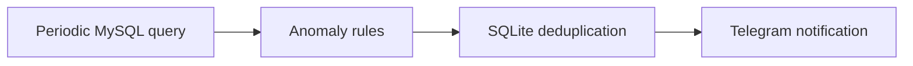

# Maintenance Alert Bot

A periodic MySQL monitor that deduplicates anomalies and sends Telegram alerts.

**Python, python-telegram-bot, MySQL, SQLite**

## What it does

- Polls maintenance data on a configured interval.
- Evaluates anomaly rules and uses SQLite state to avoid repeated alerts.
- Sends notifications only to configured Telegram destinations.

## Workflow



## Local setup and use

```powershell
python -m venv .venv
.venv\Scripts\Activate.ps1
python -m pip install -r requirements.txt
python main.py
```
Python 3.11+ is recommended. Tkinter requires a desktop Python installation.
Configure `.env` from `.env.example`: a read-only MySQL account, bot token, explicit authorized-user list and alert chat IDs are required. Keep the local SQLite state between restarts.

## Configuration

Environment names declared by the included examples (values must be supplied locally):

`COLD_START_DAYS`, `LOG_LEVEL`, `MYSQL_DATABASE`, `MYSQL_HOST`, `MYSQL_PASSWORD`, `MYSQL_PORT`, `MYSQL_USER`, `POLL_INTERVAL_SECONDS`, `STEADY_STATE_BUFFER_MINUTES`, `TELEGRAM_ALERT_CHAT_IDS`, `TELEGRAM_ALLOWED_USERS`, `TELEGRAM_BOT_TOKEN`.

## Boundaries and limitations

Actual alerts, database connectivity and delivery were not exercised during publication review. Cold-start windows and query rules must be reviewed for the target schema. No tokens, chat IDs or maintenance records are bundled.

This is a source snapshot, not a claim of production readiness. Business results, dates and unmeasured performance are intentionally not asserted. Application UI language is preserved.

## License

No new distribution license is granted for this corporate source edition. Public visibility does not grant reuse rights; obtain permission from the relevant rights holder. Existing third-party notices remain applicable.

## Verification record

See [snapshot checks and remaining limitations](docs/VERIFICATION.md).
